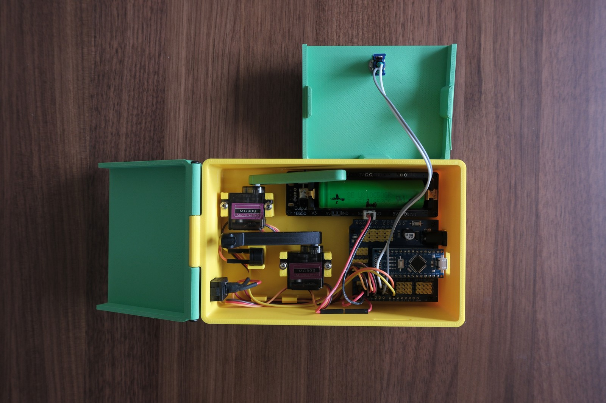

# Useless Music Box with Arduino Nano



The useless box, with a twist: when you flip the toggle switch the lid lifts, a printed finger comes out, a buzzer plays one of ten short tunes (Super Mario, Tetris, Star Wars and friends), and the finger flips the switch back off before the lid closes. Two MG90S micro servos (SG90 also fits), an Arduino Nano on an expansion board, a passive buzzer and an 18650 cell in a holder with a 5 V output; everything else is printed. This is a refurbished remix of [Useless Music Box](https://www.printables.com/model/1747960-useless-music-box) by Dawieder (Printables, CC0 public domain).

## Install and build guide

Remix of the Useless Music Box by Dawieder (Printables model 1747960, public domain). Written from scratch from the upstream model page and the firmware project. Read it once before printing.

### 1. Firmware first

The sketch is the original author's project at https://github.com/Dawied/Useless-Music-Box (use commit 329e46acdc6e, the version this guide was written against). It is not included in this repository (the firmware project carries no licence file, so it is linked, not copied); download it from that link.

1. Install the Arduino IDE 2.x (or PlatformIO; the project has a `platformio.ini` with the `nanoatmega328` environment). Board: **Arduino Nano**, processor **ATmega328P** (try "old bootloader" if the upload times out on a cheap clone).
2. Libraries: **Servo** (built in) and **Streaming** (Mikal Hart) from the Library Manager. The repo also carries both under `lib/`.
3. Open `src/main.cpp`, rename it to a `.ino` if you use the Arduino IDE, and flash it. Serial monitor at 9600 baud.
4. Pin table (from `main.cpp`):

| Signal | Nano pin |
|---|---|
| Lid servo | D2 |
| Switch servo | D3 |
| Toggle switch (to GND, internal pull-up) | D4 |
| Passive buzzer | D7 |

5. Servo end positions are two numbers in the sketch: switch finger 15 -> 115 degrees, lid finger 90 -> 5 degrees. You will tune these after test-fitting (step 4).

### 2. Printing the parts

Print one each of `box.stl`, `lid_hinge.stl`, `lid_fixed.stl`, `switch_finger.stl`, `lid_finger.stl` and `cable_holder.stl`. The six files are in [`print-files/`](print-files/). The author printed with a 0.6 mm nozzle and supports; a 0.4 mm nozzle works, and most parts print without supports if you orient the fingers flat. PLA, 0.2 mm layers, 3 walls. About 5 hours total.

### 3. Electronics and wiring

1. Mount the Nano on the I/O expansion shield: every pin comes out as a G/V/S 3-pin header, so the servos plug straight in and the rest is Dupont wires, no soldering. (A screw-terminal Nano adapter has no servo headers; it is not the board for this build.)
2. 18650 holder with 5 V output: solder two male Dupont wires to its 5 V output and GND. Put the main rocker switch between the holder's + output and a V pin of the expansion board; GND to a G pin. The battery holder you buy must have a 5 V boost output (an "18650 battery shield" with USB and 5 V/3 V pins); a plain holder gives 3.7 V, which is too low for the servos.
3. Servos: lid servo to the D2 header (signal, 5 V, GND), switch servo to D3.
4. Toggle switch: one terminal to D4, the other to GND. The sketch uses the internal pull-up, so no resistor.
5. Passive buzzer: + to D7, - to GND, with Dupont wires; it clicks into the buzzer pocket in the box.
6. Fix the expansion board and the battery holder in the box with the 8 M2 x 4 mm screws.

### 4. Fitting the fingers

1. Power up once with the servos connected but the fingers off: the sketch moves both servos to their rest positions.
2. Press the **switch finger** onto the switch servo horn so that, at rest, it stops a few millimetres before the back wall of the box.
3. Press the **lid finger** onto the lid servo horn so that, at rest, it sits a few millimetres above the battery.
4. Fit the toggle switch into the hole in the lid and tighten its ring nut.
5. If a finger over- or under-travels, change the end angles in the sketch (115 for the switch finger, 5 for the lid finger) in steps of 5 degrees and re-flash.

### 5. Assembly

1. Push the MG90S servos into their printed retainers in the box.
2. Hinge: a short piece of 1.75 mm filament through the hinge knuckles of `lid_hinge.stl` and the box.
3. Snap `lid_fixed.stl` into the box.
4. Route the buzzer and battery wires through the cable holder so they stay clear of the fingers.

### 6. First run

Main switch on, flip the toggle: lid opens, a random tune plays, the finger flips the toggle back, the lid closes. Send any serial command at 9600 baud to see the debug output if something does not move.

### 7. Troubleshooting

- Servos twitch or the Nano resets when a tune plays: battery holder output cannot supply the servo peaks; charge the cell or use a holder with a stronger boost converter.
- Finger does not reach the switch: increase the end angle, or check the horn is seated one spline further.
- Nothing happens when the toggle is flipped: D4 must read LOW when the switch is on; swap to the other pair of switch terminals.
- No sound: the buzzer must be a passive type (it needs the tone signal); an active buzzer only beeps one note.

## Bill of Material and build guide (PDF)

- **Bill of Material:** [`docs/Useless Music Box with Arduino Nano - Bill of Material.pdf`](docs/Useless%20Music%20Box%20with%20Arduino%20Nano%20-%20Bill%20of%20Material.pdf) - every purchased part with quantity, notes and a shop link per row.
- **Build Guide:** [`docs/Useless Music Box with Arduino Nano - Build Guide.pdf`](docs/Useless%20Music%20Box%20with%20Arduino%20Nano%20-%20Build%20Guide.pdf) - the guide above as a printable PDF.

## Documentation download

This repository is the documentation and print-file download for the build.

- **Download ZIP:** use GitHub's **Code -> Download ZIP** button, or clone:

  ```bash
  git clone https://github.com/ToolKnox/hawkridge-useless-music-box.git
  ```

- **Build guide:** this README, also as [`docs/build-guide.md`](docs/build-guide.md).
- **Print files (STL, 6 parts):** [`print-files/`](print-files/) - box, hinged lid, fixed lid, switch finger, lid finger and cable holder. PLA.
- **Firmware:** [https://github.com/Dawied/Useless-Music-Box](https://github.com/Dawied/Useless-Music-Box) by the original author (this guide was written against commit `329e46acdc6e`). Not included here.
- **Original uploads and listing photos:** [`source/upstream/`](source/upstream/).

## Repository contents

- `docs/`: the build guide (Markdown and PDF), the Bill of Material PDF, the upstream licence record and a manifest with the SHA-256 of every mirrored file.
- `images/`: cover photo (1600 px copy of an original listing photo).
- `print-files/`: the 6 STL files to print, one per part, unmodified from the original design (file names use underscores instead of spaces).
- `source/upstream/`: the 6 STL uploads and 4 listing photos of the original design as published on Printables (model 1747960, 2026-06-08), unmodified, plus `UPSTREAM.md` with the original description.

## Credits and license

Original design: [Useless Music Box](https://www.printables.com/model/1747960-useless-music-box) by Dawieder, released under [CC0 1.0 Universal](https://creativecommons.org/publicdomain/zero/1.0/) (public domain dedication) on Printables. The STL files and photos under `print-files/` and `source/upstream/` are unmodified copies. The CC0 text is kept at [`LICENSE`](LICENSE) and [`docs/upstream-license.txt`](docs/upstream-license.txt). The tunes in the firmware come from Robson Couto's "Songs for Arduino". No endorsement by the original author is implied.

The firmware ([https://github.com/Dawied/Useless-Music-Box](https://github.com/Dawied/Useless-Music-Box)) is the original author's separate project and carries no licence file, so it is linked here and not copied.

Changes by Hawkridge, updated for modern use: a current-parts Bill of Material (battery shield, MG90S, switches) and a rewritten build guide with firmware-first bring-up and finger alignment steps. The build guide, the Bill of Material and this README are shared under the same CC0 1.0 dedication.
